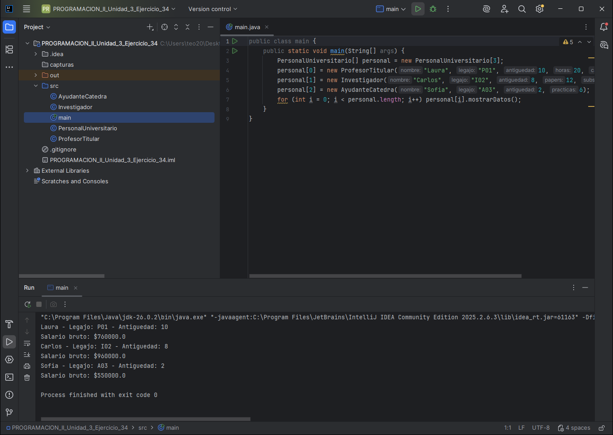

# PROGRAMACIÓN II — Unidad 3, Ejercicio 34: Gestión de Personal Docente e Investigador en Universidades

Trabajo práctico de Programación II. Este repositorio contiene la resolución en Java del ejercicio 34 de la Unidad 3.

## Consigna

#### Contexto

Las instituciones de educación superior agrupan a su plantel académico bajo normativas laborales comunes que registran el DNI, el nombre y la antigüedad. No obstante, las responsabilidades y retribuciones de los profesores titulares, los investigadores de tiempo completo y los ayudantes de cátedra varían considerablemente según su dedicación horaria y producción científica.

#### Consigna

Implementar una jerarquía de clases en Java que permita gestionar distintos tipos de personal universitario mediante el uso de herencia y especialización de funciones.

#### Desarrollo requerido

- Definir la clase base PersonalUniversitario con atributos comunes (nombre, legajo, antiguedadAnios) y métodos de consulta estándar.
- Crear las clases hijas ProfesorTitular (con atributos de horas frente a alumnos y categoría de docencia), Investigador (con cantidad de papers publicados y subsidio asignado) y AyudanteCatedra (con asignación de prácticas).
- Incorporar la sobrescritura de métodos para calcular el salario mensual bruto considerando bonos por investigación o docencia según corresponda.
- En el método main, instanciar objetos de las subclases, invocar sus cálculos de retribución y desplegar un reporte institucional por consola.

## Estructura del repositorio

```
PROGRAMACION_II_Unidad_3_Ejercicio_34/
├── README.md
├── capturas/
│   └── consola.png
└── src/
    ├── AyudanteCatedra.java
    ├── Investigador.java
    ├── main.java   # clase con el método main
    ├── PersonalUniversitario.java
    └── ProfesorTitular.java
```

## Funcionamiento y lógica

El ejercicio aplica **herencia y sobrescritura reutilizando el método de la clase base** (`super.calcularSalario()`) para liquidar sueldos del personal universitario.

### `PersonalUniversitario` (clase base)

Tiene `nombre`, `legajo` y `antiguedadAnios` (`protected`).

- **`calcularSalario()`:** sueldo básico de $500000 más $10000 por cada año de antigüedad.
- **`mostrarDatos()`:** imprime los datos y el salario bruto.

### Subclases

Cada una sobrescribe `calcularSalario()`: toma el cálculo base con `super.calcularSalario()` y le suma su propio adicional.

- **`ProfesorTitular`:** + $8000 por hora frente a alumnos.
- **`Investigador`:** + $15000 por paper publicado + el subsidio asignado.
- **`AyudanteCatedra`:** + $5000 por práctica asignada.

### `main`

Crea un arreglo `PersonalUniversitario[]` y lo recorre mostrando los datos de cada integrante:

| Persona | Cálculo | Salario |
|---|---|---|
| Laura (profesora, 10 años, 20 horas) | 600000 + 160000 | **$760000** |
| Carlos (investigador, 8 años, 12 papers, subsidio $200000) | 580000 + 180000 + 200000 | **$960000** |
| Sofía (ayudante, 2 años, 6 prácticas) | 520000 + 30000 | **$550000** |

## Ejecución

Captura de la consola de IntelliJ IDEA ejecutando el programa:



Salida obtenida:

```
Laura - Legajo: P01 - Antiguedad: 10
Salario bruto: $760000.0
Carlos - Legajo: I02 - Antiguedad: 8
Salario bruto: $960000.0
Sofia - Legajo: A03 - Antiguedad: 2
Salario bruto: $550000.0
```
